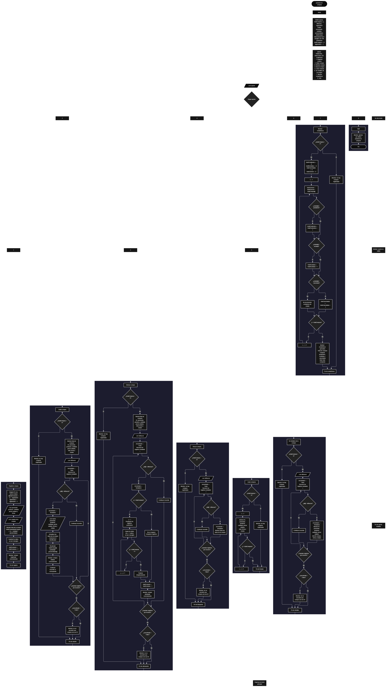

Este proyecto, llamado <b>asistente de compras</b>, fue desarrollado en <b>pseint</b> como un ejercicio práctico para fortalecer la lógica de programación mediante la creación de un sistema de gestión de compras desde la consola. El programa cuenta con un menú principal de ocho opciones que permite <b>registrar, editar, eliminar, buscar, listar y consultar los detalles de las compras registradas, además de mostrar estadísticas generales</b>. Cada compra almacena información como el identificador, el nombre del proveedor, el producto, la cantidad, el precio unitario, el valor total, la fecha y el estado de la compra, utilizando ocho arreglos paralelos dimensionados para 100 posiciones. Durante su desarrollo se aplicaron conceptos fundamentales de programación, como variables, arreglos, estructuras condicionales, ciclos repetitivos y estructuras de selección, además de procesos para buscar, modificar, eliminar y reorganizar registros. Este proyecto permite poner en práctica los conocimientos adquiridos en PSeInt y sirve como base para desarrollar sistemas de gestión de compras más avanzados utilizando otros lenguajes y tecnologías.

<h2 align="center">⚙️ Funcionamiento del menú principal</h2>

### ➕ Registrar compra

La opción <b>1) registrar compra</b> permite almacenar una nueva compra en el sistema. Al comenzar, el programa asigna un identificador utilizando la variable <b>siguienteID</b> y aumenta su valor en uno para que el próximo registro reciba un identificador consecutivo. Después, solicita el nombre del proveedor, el producto, la cantidad, el precio unitario, la fecha de compra y el estado, que puede ser pendiente, recibida o cancelada según las opciones indicadas por el programa. Una vez introducidos los datos, calcula automáticamente el valor total mediante la operación <b>cantidad * precioUnitario</b> y almacena el resultado en el arreglo <b>totalCompra</b>. Finalmente, aumenta la variable <b>totalCompras</b> en uno y muestra el mensaje <b>"compra registrada correctamente."</b>. Aunque los arreglos están dimensionados para 100 posiciones, esta opción no incluye una comprobación que impida registrar más compras cuando se alcanza esa capacidad.

### ✏️ Editar compra

La opción <b>2) editar compra</b> permite modificar la información de una compra registrada. Primero, el programa comprueba si la variable <b>totalCompras</b> es igual a cero. Si no existen compras almacenadas, muestra el mensaje <b>"no hay compras registradas."</b>. En caso contrario, presenta una lista con el identificador, proveedor, producto, cantidad, precio unitario, total de la compra, fecha y estado de cada registro. Después, solicita el identificador de la compra que se desea editar y utiliza la variable lógica <b>encontrado</b> para determinar si existe una coincidencia. Cuando encuentra el identificador, permite introducir el nuevo proveedor, producto, cantidad, precio, fecha y estado. El identificador se conserva y el valor total se calcula nuevamente mediante la operación <b>cantidad * precioUnitario</b>. Finalmente, muestra el mensaje <b>"compra editada correctamente."</b>. Si no encuentra una compra con el identificador introducido, presenta el mensaje <b>"no se encontro una compra con ese id."</b>.

### 🗑️ Eliminar compra

La opción <b>3) eliminar compra</b> permite eliminar una compra mediante su identificador. Antes de realizar la operación, el programa comprueba si existen compras registradas. Si no hay registros, muestra el mensaje <b>"no hay compras registradas."</b>. Si existen compras, presenta una lista con sus datos y solicita el identificador que se desea eliminar. A continuación, inicializa la variable lógica <b>encontrado</b> con el valor <b>falso</b> y recorre los identificadores almacenados. Cuando encuentra una coincidencia, cambia la variable a <b>verdadero</b> y comprueba si la compra seleccionada se encuentra antes de la última posición ocupada. Si es así, utiliza un ciclo <b>para</b>, controlado por la variable <b>j</b>, para desplazar una posición hacia la izquierda los datos posteriores en los ocho arreglos: <b>id, proveedor, producto, cantidad, precioUnitario, totalCompra, fecha y estado</b>. Después, disminuye la variable <b>totalCompras</b> en uno y muestra el mensaje <b>"compra eliminada correctamente."</b>. Si no encuentra el identificador solicitado, presenta el mensaje <b>"no se encontro una compra con ese id."</b>. El código no limpia expresamente la última posición después de eliminar una compra ni interrumpe el ciclo exterior tras encontrar una coincidencia.

### 🔎 Buscar compra

La opción <b>4) buscar compra</b> permite localizar una compra mediante su identificador. Primero, el programa comprueba si existen compras registradas. Si no hay registros, muestra el mensaje <b>"no hay compras registradas."</b>. En caso contrario, solicita el identificador de la compra que se desea buscar e inicializa la variable lógica <b>encontrado</b> con el valor <b>falso</b>. Después, utiliza un ciclo <b>para</b> para recorrer los identificadores almacenados y compararlos con el valor introducido mediante la condición <b>id[i] = idBuscar</b>. Cuando encuentra una coincidencia, cambia la variable <b>encontrado</b> a <b>verdadero</b> y muestra el identificador, el proveedor, el producto, la cantidad, el precio unitario, el total de la compra, la fecha y el estado. Si finaliza el recorrido sin encontrar coincidencias, presenta el mensaje <b>"no se encontro una compra con ese id."</b>.

### 📋 Listar compras

La opción <b>5) listar compras</b> permite visualizar todas las compras registradas actualmente en el sistema. Antes de mostrar los datos, el programa comprueba si la variable <b>totalCompras</b> es igual a cero. Si no existen registros, presenta el mensaje <b>"no hay compras registradas."</b>. Si hay compras disponibles, utiliza un ciclo <b>para</b> para recorrer los arreglos desde la primera posición hasta la cantidad total de compras almacenadas. Durante el recorrido, muestra el identificador, proveedor, producto, cantidad, precio unitario, total de la compra, fecha y estado de cada registro. Esta función facilita consultar la información de las compras existentes sin necesidad de buscar cada una individualmente.

### 📄 Ver detalles de la compra

La opción <b>6) ver detalles de la compra</b> permite consultar la información completa de una compra específica. Primero, el programa comprueba si existen compras registradas. Si el sistema está vacío, muestra el mensaje <b>"no hay compras registradas."</b>. En caso contrario, solicita el identificador de la compra que se desea consultar e inicializa la variable lógica <b>encontrado</b> con el valor <b>falso</b>. A continuación, recorre los identificadores mediante un ciclo <b>para</b> y compara cada uno con el valor introducido. Si encuentra una coincidencia, cambia la variable <b>encontrado</b> a <b>verdadero</b> y muestra los datos por separado: identificador, proveedor, producto, cantidad, precio unitario, total de la compra, fecha y estado. Si el identificador no corresponde a ninguna compra registrada, presenta el mensaje <b>"no se encontro una compra con ese id."</b>.

### 📊 Mostrar estadísticas

La opción <b>7) mostrar estadisticas</b> permite obtener un resumen general de las compras registradas. Primero, el programa comprueba si existen compras almacenadas. Si no hay registros, muestra el mensaje <b>"no hay compras registradas."</b>. Si existen compras, inicializa los contadores <b>totalPendientes, totalRecibidas y totalCanceladas</b>, junto con el acumulador <b>totalGeneral</b>, en cero. Después, utiliza un ciclo <b>para</b> para recorrer las compras y sumar los valores almacenados en el arreglo <b>totalCompra</b>. Durante el mismo recorrido, comprueba el estado de cada registro y aumenta el contador correspondiente cuando coincide exactamente con <b>"pendiente"</b>, <b>"recibida"</b> o <b>"cancelada"</b>. Al finalizar, muestra las estadísticas generales: cantidad total de compras, compras pendientes, compras recibidas, compras canceladas y valor total comprado. Los estados diferentes de los tres valores indicados no se incluyen en esos contadores.

### 🚪 Salir del menú principal

La opción <b>8) salir</b> permite finalizar el uso del asistente de compras y muestra el mensaje <b>"gracias por utilizar asistente de compras."</b>. El menú principal se encuentra dentro de una estructura repetitiva <b>repetir ... hasta que</b>, que mantiene el programa en funcionamiento mientras el usuario realiza las diferentes operaciones disponibles. En este caso, la condición final es <b>hasta que opcion = 8</b>, por lo que al seleccionar la opción 8 el ciclo termina correctamente y finaliza la ejecución del algoritmo.

<h2 align="center">🧠 Temas aplicados en el proyecto</h2>

### 📦 Variables

En este proyecto se utilizan variables para controlar las opciones del menú, almacenar la cantidad de compras registradas, asignar identificadores, recorrer los arreglos, buscar compras específicas, calcular importes y determinar si se encontró un registro. También se utilizan variables para obtener estadísticas sobre los estados de las compras y acumular el valor total de las operaciones registradas.

🔢 <b>Opcion:</b> Almacena la opción seleccionada por el usuario en el menú principal.

📊 <b>TotalCompras:</b> Controla la cantidad actual de compras registradas.

🆔 <b>SiguienteID:</b> Almacena el próximo identificador que se asignará a una nueva compra.

🔄 <b>I:</b> Funciona como contador en los ciclos <b>para</b> utilizados para recorrer los arreglos.

🔁 <b>J:</b> Controla el recorrido utilizado para desplazar los datos de las compras durante la eliminación de un registro.

🔎 <b>IDBuscar:</b> Almacena el identificador introducido por el usuario para buscar, editar, eliminar o consultar una compra.

✅ <b>Encontrado:</b> Variable lógica que indica si se ha encontrado una compra con el identificador solicitado.

🔢 <b>Cantidad:</b> Almacena la cantidad de unidades de un producto incluidas en una compra.

💰 <b>PrecioUnitario:</b> Almacena el precio correspondiente a una unidad del producto.

💵 <b>TotalCompra:</b> Almacena el importe total de cada compra, calculado multiplicando la cantidad por el precio unitario.

🏢 <b>Proveedor:</b> Almacena el nombre del proveedor de la compra.

📦 <b>Producto:</b> Almacena el nombre del producto comprado.

📅 <b>Fecha:</b> Almacena la fecha de la compra.

📌 <b>Estado:</b> Almacena el estado indicado para la compra.

📈 <b>TotalPendientes, TotalRecibidas y TotalCanceladas:</b> Se utilizan para contar las compras que coinciden con cada uno de los tres estados contemplados en las estadísticas.

🧮 <b>TotalGeneral:</b> Acumula el valor total de las compras registradas.

### 🗃️ Arreglos

En este proyecto se utilizan ocho arreglos paralelos dimensionados para <b>100 posiciones</b>. Cada arreglo almacena un dato específico de las compras y utiliza el mismo índice para relacionar los datos correspondientes a un mismo registro. Por ejemplo, la información de una compra situada en la posición <b>1</b> se encuentra distribuida entre <b>id[1], proveedor[1], producto[1], cantidad[1], precioUnitario[1], totalCompra[1], fecha[1] y estado[1]</b>. Esta organización permite recorrer, buscar, modificar, mostrar y eliminar compras mediante sus posiciones correspondientes.

🆔 <b>Id[100]:</b> Almacena los identificadores de las compras registradas.

🏢 <b>Proveedor[100]:</b> Almacena los nombres de los proveedores.

📦 <b>Producto[100]:</b> Almacena los nombres de los productos comprados.

🔢 <b>Cantidad[100]:</b> Almacena las cantidades de unidades correspondientes a cada compra.

💰 <b>PrecioUnitario[100]:</b> Almacena los precios unitarios de los productos.

💵 <b>TotalCompra[100]:</b> Almacena el importe total de cada compra.

📅 <b>Fecha[100]:</b> Almacena las fechas de las compras.

📌 <b>Estado[100]:</b> Almacena los estados de las compras.

### 🔀 Estructuras condicionales

En este proyecto se utilizan las estructuras <b>si</b> y <b>sino</b> para comprobar si existen compras registradas antes de ejecutar las operaciones, determinar si se encuentra una compra con el identificador introducido, decidir si es necesario desplazar los datos al eliminar un registro y clasificar las compras según su estado. Estas condiciones permiten que el programa responda de manera diferente según la información almacenada y el resultado de cada operación.

### 🔄 Estructuras repetitivas

En este proyecto se utilizan los ciclos <b>para</b> y <b>repetir ... hasta que</b>. Los ciclos <b>para</b> permiten recorrer los arreglos para mostrar, buscar, editar y consultar las compras registradas. También se utilizan para reorganizar los datos posteriores cuando se elimina una compra y para calcular las estadísticas generales. Por otro lado, el ciclo <b>repetir ... hasta que</b> mantiene activo el menú principal y permite ejecutar diferentes operaciones hasta que el usuario selecciona la opción <b>8) salir</b>.

### 🎯 Estructura según

El programa utiliza la estructura <b>segun</b> para evaluar el valor almacenado en la variable <b>opcion</b> y ejecutar el bloque de instrucciones correspondiente. Cada caso representa una operación específica del sistema: <b>registrar, editar, eliminar, buscar, listar, ver detalles, mostrar estadísticas o salir</b>. También se utiliza el bloque <b>de otro modo</b> para mostrar el mensaje <b>"opcion no valida."</b> cuando el valor introducido no coincide con ninguna de las opciones definidas en el menú principal.

### 🔢 Dimensionamiento de arreglos

El programa utiliza la instrucción <b>dimension</b> para establecer la capacidad de los ocho arreglos que almacenan la información de las compras. Cada arreglo está dimensionado para <b>100 posiciones</b>, lo que permite disponer de ese espacio de almacenamiento durante la ejecución. La cantidad de registros activos se controla mediante la variable <b>totalCompras</b>, que aumenta al registrar una compra y disminuye al eliminarla. Sin embargo, el programa no comprueba si se ha alcanzado la capacidad de los arreglos antes de registrar un nuevo elemento, por lo que el límite de 100 posiciones no está protegido mediante una validación.

### 🔄 Reorganización de registros

Cuando se elimina una compra que no se encuentra en la última posición ocupada, el programa utiliza un ciclo <b>para</b>, controlado por la variable <b>j</b>, que recorre las posiciones desde el identificador seleccionado hasta <b>totalCompras - 1</b>. En cada repetición, copia los datos de la posición siguiente sobre la posición actual en los ocho arreglos: <b>id, proveedor, producto, cantidad, precioUnitario, totalCompra, fecha y estado</b>. Después, la variable <b>totalCompras</b> disminuye en uno. De esta manera, los registros posteriores se desplazan hacia la izquierda para ocupar las posiciones anteriores. El código no limpia expresamente la última posición después de la eliminación, aunque esa posición deja de formar parte del rango de registros activos controlado por <b>totalCompras</b>.

<h2 align="center">¿Cómo se implementaron las operaciones crud en el proyecto?</h2>

Las operaciones <b>crud</b> se implementaron mediante las opciones del menú principal, permitiendo administrar las compras registradas. La operación <b>crear</b> corresponde a <b>registrar compra</b>, donde se introducen los datos de un nuevo registro y se calcula su valor total; <b>leer</b> se realiza mediante las opciones <b>buscar compra, listar compras y ver detalles de la compra</b>; <b>actualizar</b> corresponde a <b>editar compra</b>, donde se modifican los datos de una compra existente y se recalcula su importe; y <b>eliminar</b> se realiza mediante la opción <b>eliminar compra</b>, que reorganiza los datos de los arreglos cuando es necesario. Estas operaciones utilizan variables, arreglos, estructuras condicionales y ciclos para gestionar la información almacenada temporalmente durante la ejecución del programa.

<h2 align="center">Diagrama de flujo del proyecto</h2>

<h2 align="center">🛡️ Validaciones del programa</h2>

### 📭 No existen compras registradas

Esta comprobación se utiliza en las opciones de <b>editar, eliminar, buscar, listar, ver detalles y mostrar estadísticas</b>. El programa comprueba si la variable <b>totalCompras</b> es igual a <b>0</b> y, si no existen compras registradas, muestra el mensaje <b>"no hay compras registradas."</b>. Esta condición evita continuar con las operaciones que necesitan información almacenada cuando el sistema está vacío.

### ❌ Compra no encontrada

Esta comprobación se utiliza durante las operaciones de <b>editar, eliminar, buscar y ver detalles de la compra</b>. El programa inicializa la variable lógica <b>encontrado</b> con el valor <b>falso</b> y recorre el arreglo <b>id</b> para comparar cada identificador con el valor introducido por el usuario. Cuando encuentra una coincidencia, cambia la variable a <b>verdadero</b> y ejecuta la operación correspondiente. Si finaliza el recorrido sin encontrar una coincidencia, muestra el mensaje <b>"no se encontro una compra con ese id."</b>.

### 🧮 Cálculo automático del importe

Durante el registro y la edición de una compra, el programa calcula el importe total multiplicando la cantidad de unidades por el precio unitario. El resultado se almacena en el arreglo <b>totalCompra</b> mediante la operación <b>cantidad[i] * precioUnitario[i]</b> o su posición correspondiente. Este cálculo también se utiliza posteriormente para acumular el valor total de las compras en la opción de estadísticas. Sin embargo, el programa no valida que la cantidad o el precio introducidos sean positivos.

### 📌 Clasificación de las compras por estado

En la opción de estadísticas, el programa compara el valor almacenado en el arreglo <b>estado</b> con las cadenas <b>"pendiente"</b>, <b>"recibida"</b> y <b>"cancelada"</b>. Cuando encuentra una coincidencia exacta, aumenta el contador correspondiente. No obstante, esta clasificación no constituye una validación de los datos introducidos durante el registro o la edición. Si se introduce otro estado, el programa lo almacena, pero no lo contabiliza en ninguno de los tres grupos.

### ⚠️ Capacidad de los arreglos

Los ocho arreglos están dimensionados para <b>100 posiciones</b>. Sin embargo, la opción de registro no comprueba si la variable <b>totalCompras</b> ha alcanzado ese límite antes de guardar una nueva compra. Por tanto, el programa no dispone de una validación que impida superar la capacidad dimensionada. Para garantizar que no se intente utilizar una posición fuera del rango disponible, sería necesario incorporar una comprobación antes de registrar nuevos datos.

### 🔢 Opción inválida

La estructura <b>segun</b> incluye el bloque <b>de otro modo</b>, que muestra el mensaje <b>"opcion no valida."</b> cuando el usuario introduce un valor que no corresponde a ninguna de las ocho opciones definidas en el menú. Esta comprobación permite informar al usuario cuando la selección no coincide con una operación disponible.

<h2 align="center">🎯 Objetivo del proyecto</h2>

El objetivo principal de este proyecto es fortalecer la <b>lógica de programación</b> mediante el desarrollo de un sistema de gestión de compras en <b>pseint</b>. A través de su construcción se busca aplicar los conocimientos adquiridos sobre variables, arreglos paralelos, estructuras condicionales, ciclos repetitivos y estructuras de selección, integrándolos para resolver un problema de manera organizada. Además, el proyecto permite comprender cómo registrar, consultar, modificar y eliminar información, calcular importes automáticamente y obtener estadísticas generales a partir de los datos almacenados. De esta manera, se establece una base para desarrollar sistemas de gestión de compras más completos con otros lenguajes y tecnologías.

